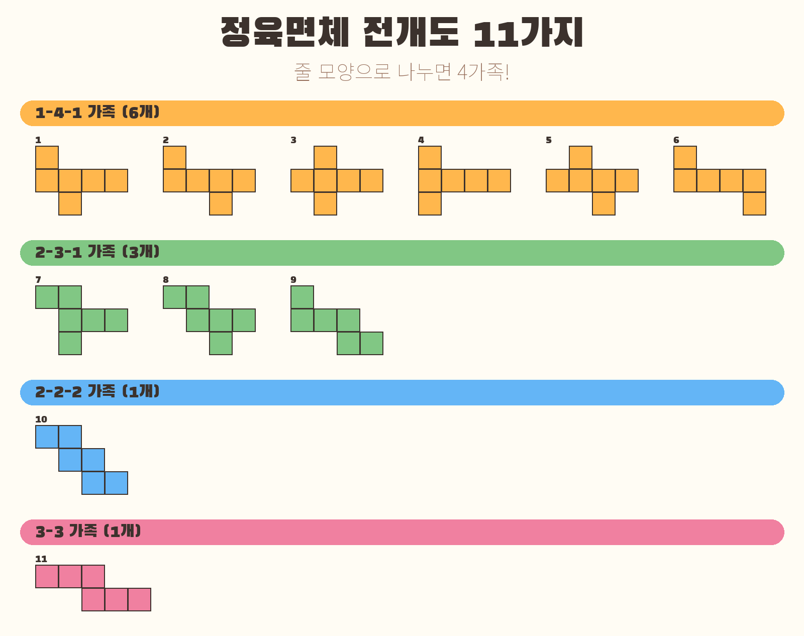
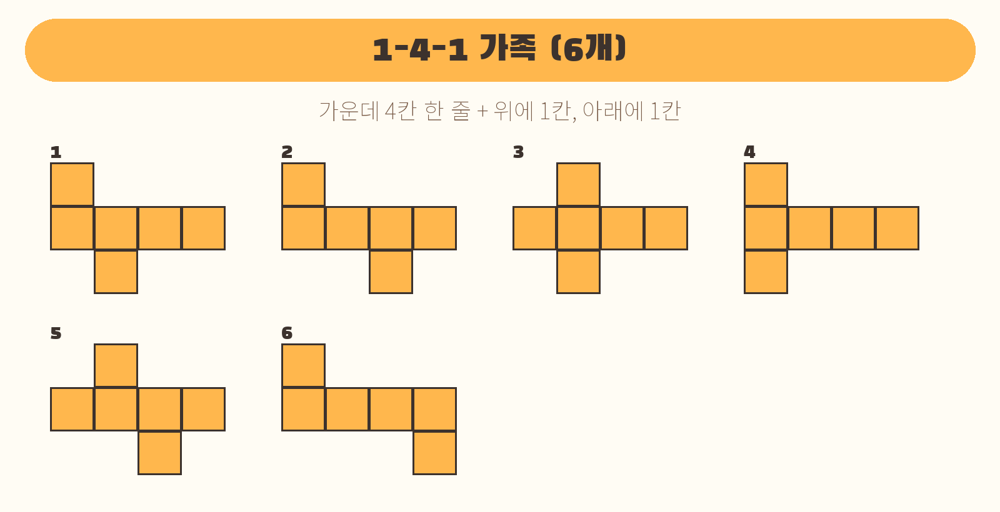
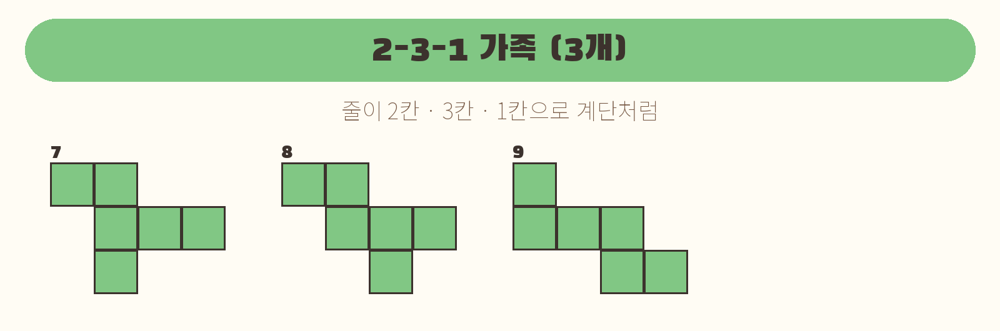
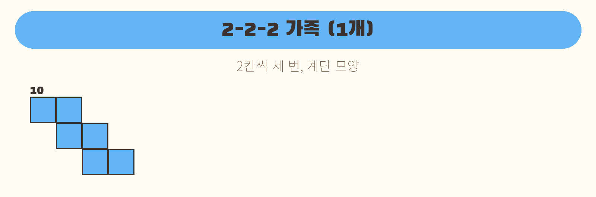
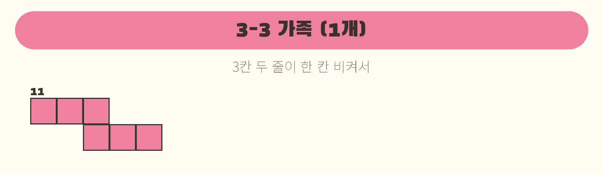
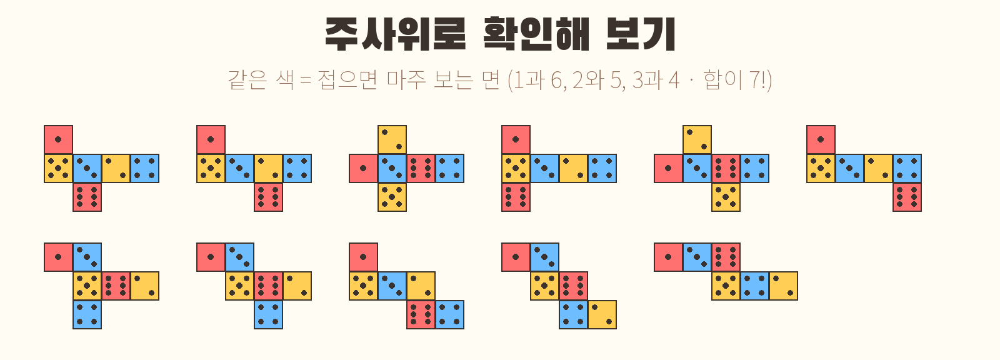
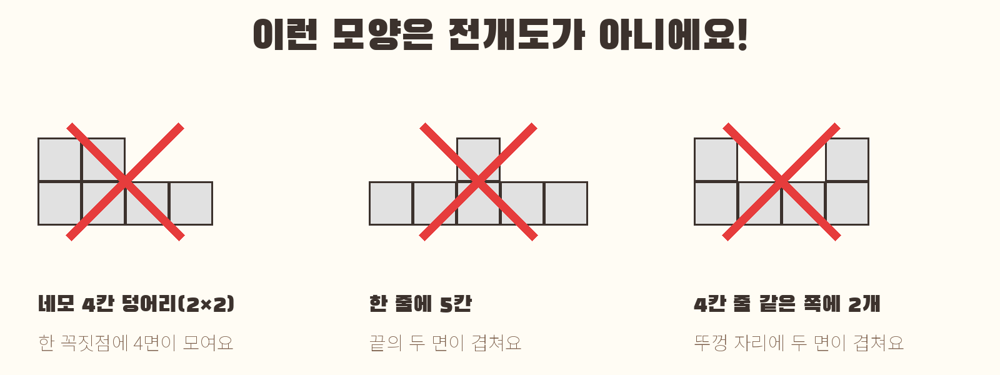

# 정육면체 전개도 11가지, 4가족으로 쉽게 외우기!

정육면체(주사위 모양)를 가위로 잘라 쫙 펼치면 정사각형 6개가 이어진 평평한 모양이 돼요. 이걸 **전개도**라고 해요.
정육면체 전개도는 **딱 11가지**뿐이에요. 하나씩 외우기보다, **줄 모양으로 4가족**으로 나눠 보면 금방 기억할 수 있어요!

> 돌리거나 뒤집어서 똑같아지는 모양은 한 가지로 세요.

---

## 1. 1-4-1 가족 (6개) — 가장 많아요!

- 가운데에 **4칸이 한 줄**로 있어요. 이 4칸이 정육면체를 빙 둘러싸는 **옆면 4개**예요.
- 줄 **위에 1칸, 아래에 1칸**이 붙어요. 이게 **뚜껑**과 **바닥**이에요.
- 위·아래 칸은 4칸 줄 어디에 붙어도 괜찮아요. 그래서 6가지나 나와요.

## 2. 2-3-1 가족 (3개)

- 줄이 **2칸 · 3칸 · 1칸**으로 이루어져요.
- 가운데 3칸 줄을 기준으로, 위에 2칸이 계단처럼 걸치고 아래에 1칸이 붙어요.

## 3. 2-2-2 가족 (1개)

- **2칸씩 세 줄**이 한 칸씩 비켜서 내려가요. **계단** 모양!

## 4. 3-3 가족 (1개)

- **3칸 두 줄**이 끝에서 한 칸만 겹쳐 이어져요.

> 외우는 말: **"육(6) 삼(3) 일(1) 일(1), 모두 열한(11) 가지!"**

---

## 주사위로 확인해 보기

주사위는 **마주 보는 두 면의 눈을 더하면 항상 7**이에요(1과 6, 2와 5, 3과 4).
아래 그림에서 **같은 색끼리는 접었을 때 서로 마주 보는 면**이에요. 11가지 모두 같은 색 두 칸이 **바로 붙어 있지 않아요!**

**꿀팁**: 한 줄로 이어진 칸에서 **한 칸 건너뛴 두 칸**은 접으면 서로 마주 봐요.

---

## 이런 모양은 전개도가 아니에요!

1. **네모 4칸 덩어리(2×2)가 있으면 ✕** — 정육면체 꼭짓점에는 면이 3개만 모이는데, 4개가 모여 버려요.
2. **한 줄에 5칸 이상이면 ✕** — 4칸으로 한 바퀴를 다 돌아서, 5번째 칸이 처음 칸과 겹쳐요.
3. **4칸 줄의 같은 쪽에 2칸이 붙으면 ✕** — 둘 다 뚜껑 자리로 가서 겹쳐요. (위 1칸, 아래 1칸이어야 해요!)

---

## 집에서 해 보기

1. 모눈종이에 11가지 전개도를 따라 그려요. (한 칸 3cm 정도가 접기 좋아요)
2. 가위로 오려서 접어 보세요. 정말 다 정육면체가 되는지 확인!
3. 각 면에 주사위 눈을 그려 보고, 마주 보는 면의 합이 7인지 세어 봐요.
4. **도전!** 아무렇게나 6칸 모양을 그리고, 접기 전에 "될까? 안 될까?" 맞혀 보기.

## 한 줄 정리

> 정육면체 전개도는 **11가지**! **1-4-1(6개) · 2-3-1(3개) · 2-2-2(1개) · 3-3(1개)**.
> **2×2 덩어리**나 **한 줄 5칸**이 보이면 바로 ✕!
